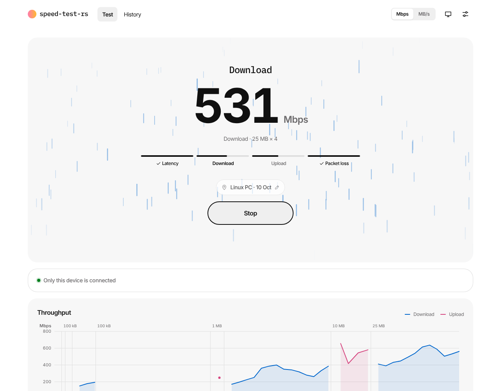
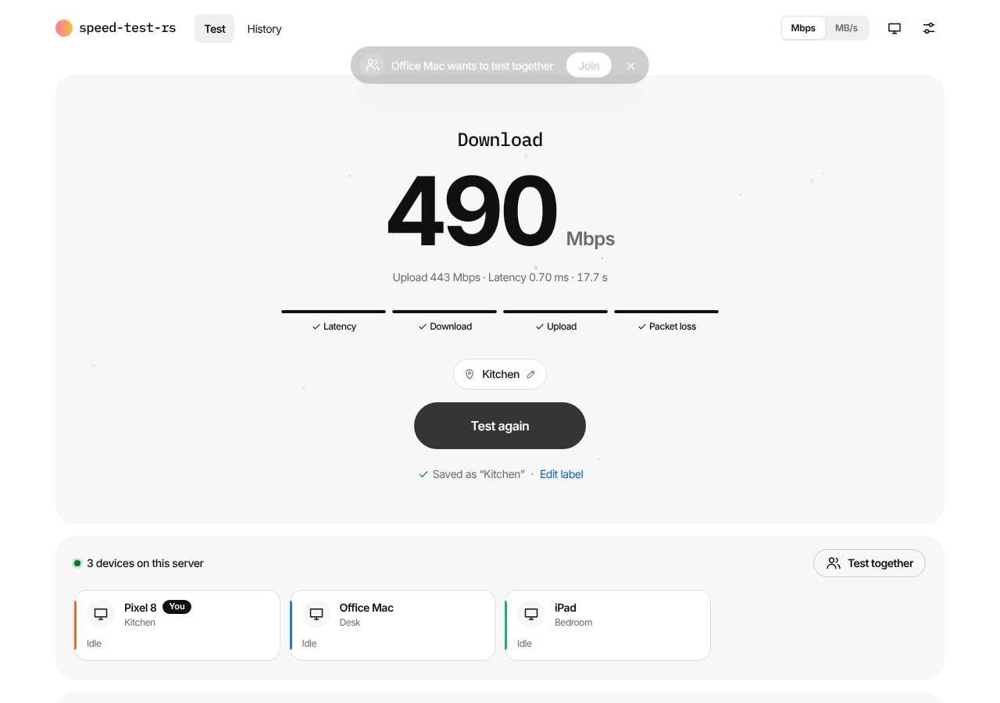
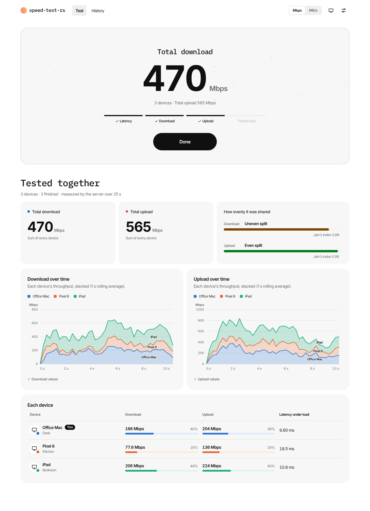
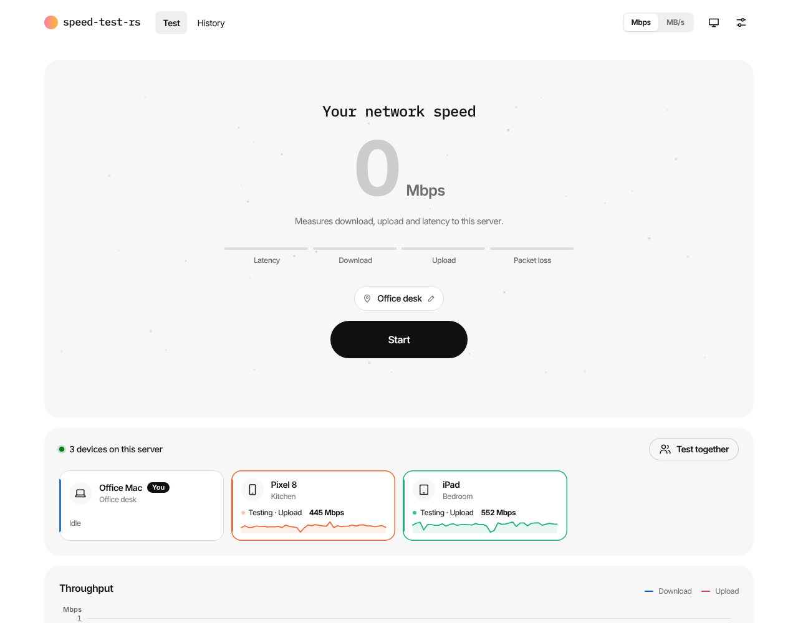
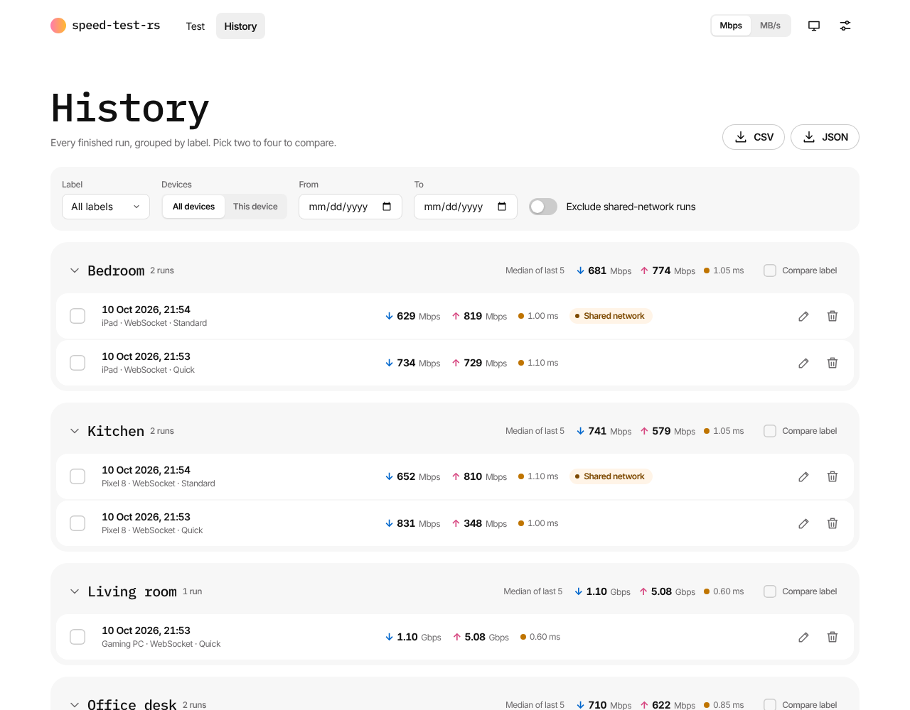
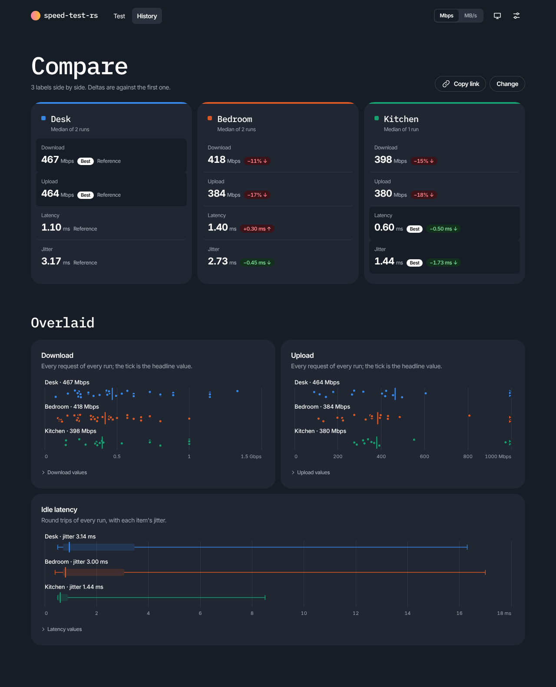

# speed-test-rs

A free, self-hosted speed test for your home or office network. Run it on any machine on your LAN, open it from any phone, laptop or TV browser, and see how fast your Wi-Fi and wired connections really are. Nothing leaves your network.



## Features

- **Download, upload, latency, jitter and packet loss**, plus latency under load ("bufferbloat") and a rating for streaming, gaming and video calls.
- **Test together** (multi-device): see below.
- **See every connected device.** Each open browser shows up live with its name and its current download or upload speed.
- **History and compare.** Every run is saved under a label like "Kitchen" or "Office desk", so you can compare rooms, routers or before/after changes.
- **Runs anywhere.** One small binary for Linux, macOS, Windows and Raspberry Pi, or a Docker image. No accounts, no cloud, no external fonts or CDN.
- **Installable** as an app on phones (PWA), with light and dark themes.

## Test together: load your network from many devices at once

Most speed tests measure one device. Real networks are shared: the TV is streaming, a laptop is on a call and a phone is uploading photos. **Test together** runs a synchronised test on every device you choose, at the same moment, and shows what your network delivers when it is busy.

1. Open the page on each device. They appear in the **Devices** panel with their live speeds.
2. On one device, press **Test together**. The others get an invite and tap **Join**.
3. The organizer presses **Start**. After a shared 3-2-1 countdown, every device downloads and then uploads at full speed at the same time.
4. The result shows the **total bandwidth**, **each device's share**, whether the split was **even or uneven**, latency under load per device, and a warning when the server's own link is the bottleneck.

The speeds come from the server's own byte counters, so they're consistent across devices. Use it to find out whether your router shares bandwidth fairly, how a mesh node holds up with several clients, or what's left for gaming while the house is streaming.

<p>
  
  
</p>

## Screenshots

<p>
  
  
</p>
<p>
  
</p>

## Run it

### Docker Compose

```yaml
# docker-compose.yml
services:
  speed-test:
    image: puttyman/speed-test-rs:latest
    restart: unless-stopped
    ports:
      - "8080:8080/tcp"
      - "3478:3478/udp"   # packet-loss test (WebRTC)
    environment:
      SPEEDTEST_PUBLIC_IP: 192.168.1.10   # this host's LAN IP, for the packet-loss test
    volumes:
      - speedtest-data:/data

volumes:
  speedtest-data:
```

```bash
docker compose up -d
```

Then open `http://<host-ip>:8080` on any device.

On Linux, host networking is simpler and fastest for multi-gigabit links (no port mapping or public IP needed):

```yaml
services:
  speed-test:
    image: puttyman/speed-test-rs:latest
    restart: unless-stopped
    network_mode: host
    volumes:
      - speedtest-data:/data

volumes:
  speedtest-data:
```

### Docker

```bash
docker run -d --name speed-test -p 8080:8080 -p 3478:3478/udp \
  -e SPEEDTEST_PUBLIC_IP=192.168.1.10 -v speedtest-data:/data \
  puttyman/speed-test-rs:latest
```

### Binary

Download the archive for your system from the [latest release](https://github.com/puttyman/speed-test-rs/releases/latest), unpack it and run:

```bash
./speed-test-rs
```

It prints the address to open (and a QR code for your phone). On macOS, run `xattr -d com.apple.quarantine speed-test-rs` once first. On Windows, allow it through the firewall on private networks.

## Options

| Option | Environment variable | Default |
|---|---|---|
| `--listen` | `SPEEDTEST_LISTEN` | `0.0.0.0:8080` |
| `--udp-port` | `SPEEDTEST_UDP_PORT` | `3478` |
| `--public-ip` | `SPEEDTEST_PUBLIC_IP` | auto (set it with Docker bridge networking) |
| `--server-name` | `SPEEDTEST_SERVER_NAME` | hostname |
| `--data-dir` | `SPEEDTEST_DATA_DIR` | `/data` in Docker |
| `--no-history` | `SPEEDTEST_HISTORY=false` | history on |
| `--no-presence` | `SPEEDTEST_PRESENCE=false` | devices panel on |

`./speed-test-rs --help` lists everything. HTTPS, reverse proxies, running as a service and tips for accurate results are in the [full guide](docs/GUIDE.md).

## Tips

- Run the server on a **wired** machine; it measures the link between your device and that machine.
- Test the same spot a few times with the same label, then use **Compare**.

## Contributing

Built in Rust (Leptos, Axum). See [CONTRIBUTING.md](CONTRIBUTING.md) and [docs/ARCHITECTURE.md](docs/ARCHITECTURE.md).

## License

MIT or Apache-2.0, at your option.
